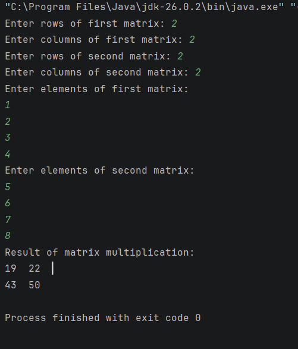

# Practical 1: Matrix Multiplication

## Aim
To write a Java program for matrix multiplication using InputStreamReader and BufferedReader classes for input and output.

## Theory
Matrix multiplication is performed by multiplying the elements of each row of the first matrix with the corresponding elements of each column of the second matrix and adding the products.

The number of columns in the first matrix must equal the number of rows in the second matrix.

## Java Concepts Used
- InputStreamReader
- BufferedReader
- Two-dimensional arrays
- Nested loops
- Matrix multiplication

## Source Code
`Practical1.java`

## Output
