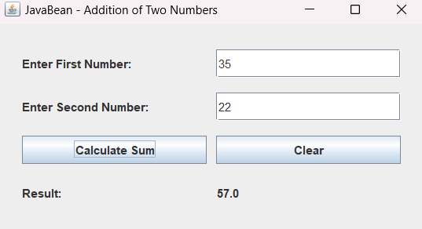

# Practical 10: JavaBean Component for Addition of Two Numbers

## Aim
To develop a JavaBean component that performs addition of two numbers and use it in a Java application.

## Theory
A JavaBean is a reusable Java software component that follows specific conventions.

A JavaBean generally has:
- Private properties.
- A public no-argument constructor.
- Public getter and setter methods.
- Support for serialization.

In this program, an AdditionBean class is created to store two numbers and calculate their sum. A Java Swing application uses this bean to accept input and display the addition result.

## Features
- Accepts two numeric values.
- Uses a JavaBean to store the numbers.
- Calculates the sum of the two numbers.
- Displays the result.
- Provides a Clear button.
- Handles invalid numeric input.

## Concepts Used
- JavaBean
- Encapsulation
- Serializable Interface
- No-Argument Constructor
- Getter and Setter Methods
- Java Swing
- JFrame
- JPanel
- JLabel
- JTextField
- JButton
- Event Handling
- Exception Handling

## Source Code
- `AdditionBean.java`
- `BeanAdditionApp.java`

## Output

## Conclusion
Successfully developed a reusable JavaBean component for addition of two numbers and integrated it into a Java Swing application.