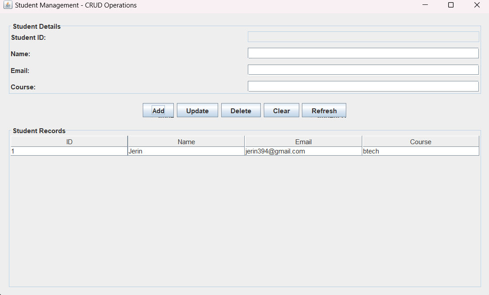

# Practical 11: CRUD Operations Using Java Swing and CSV File Handling

## Aim
To develop a Student Management application using Java Swing that performs Create, Read, Update, and Delete (CRUD) operations on student records stored in a CSV file.

## Theory
CRUD stands for Create, Read, Update, and Delete. These are the four basic operations used to manage data.

In this application, Java Swing is used to create a graphical user interface for managing student records. CSV (Comma-Separated Values) is used as the storage format.

The application allows users to add new student records, view existing records, update selected records, and delete records.

## CRUD Operations

### 1. Create
Adds a new student record to the CSV file with an automatically generated student ID.

### 2. Read
Reads student records from the CSV file and displays them in a JTable.

### 3. Update
Modifies the details of a selected student record.

### 4. Delete
Removes a selected student record from the CSV file.

## Features
- Add new student records.
- Automatically generate student IDs.
- Display all registered students.
- Update existing student details.
- Delete student records.
- Validate required fields and email addresses.
- Store records permanently in a CSV file.
- Refresh the displayed records.

## File Details
- File name: `students.csv`
- Location: `Practical 11/students.csv`

### CSV Columns
- ID
- Name
- Email
- Course

## Concepts Used
- Java Swing
- JFrame
- JPanel
- JTextField
- JButton
- JTable
- DefaultTableModel
- JScrollPane
- Event Handling
- Java File Handling
- BufferedReader
- BufferedWriter
- Files and Path
- ArrayList
- CSV File Format
- CRUD Operations

## Source Code
`StudentCRUD.java`

## Output

## Conclusion
Successfully developed a Student Management application using Java Swing and CSV file handling to perform Create, Read, Update, and Delete operations on student records.