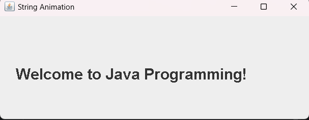

# Practical 2: String Animation Using Multithreading

## Aim
To develop a Java program that animates a string continuously using multithreading.

## Theory
Multithreading is a feature of Java that allows multiple threads to execute concurrently.

In this program, a separate thread is created to control the movement of a string inside a Swing window. The string moves from left to right continuously.

## Concepts Used
- Java Multithreading
- Thread class
- Swing (`JFrame` and `JPanel`)
- Graphics class
- `paintComponent()` method
- `repaint()` method
- Exception handling

## Source Code
`StringAnimation.java`

## Output

## Conclusion
Successfully implemented a Java string animation program using multithreading and Swing.