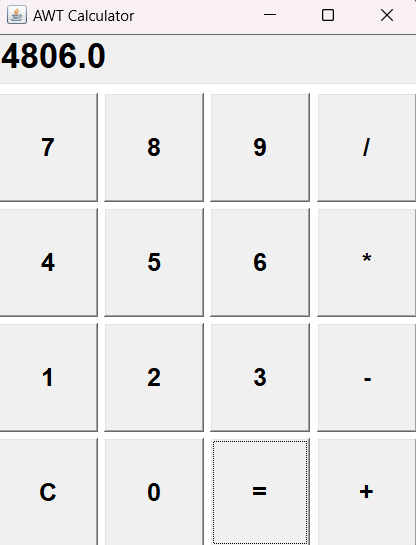

# Practical 3: Calculator Using Java AWT Controls

## Aim
To develop a simple calculator using Java AWT controls.

## Theory
Abstract Window Toolkit (AWT) is a Java GUI toolkit used to create graphical user interfaces.

This program creates a calculator window that allows users to perform basic arithmetic operations using buttons.

## Concepts Used
- Java AWT
- Frame
- Button
- TextField
- Panel
- GridLayout
- ActionListener
- ActionEvent
- Event handling

## Operations Performed
- Addition (+)
- Subtraction (-)
- Multiplication (*)
- Division (/)
- Clear (C)

## Source Code
`Calculator.java`

## Output

## Conclusion
Successfully developed a basic calculator using Java AWT controls and event handling.