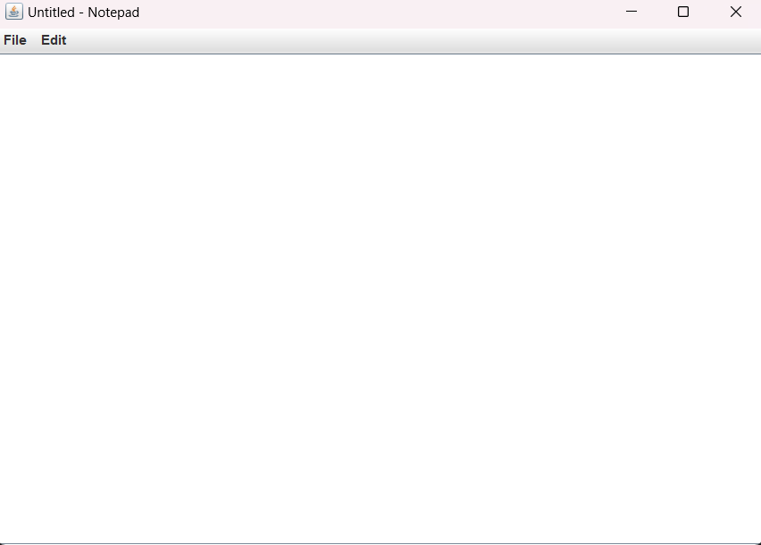

# Practical 5: Notepad Application Using Java Swing

## Aim
To develop a simple Notepad application using Java Swing with basic text editing and file management features.

## Theory
Swing is a Java GUI toolkit used to develop graphical user interface applications.

This program creates a Notepad application using JFrame and JTextArea. It provides menus for file operations and text editing.

## Features
- Create a new file
- Open an existing file
- Save a file
- Save As
- Cut text
- Copy text
- Paste text
- Select all text
- Exit the application

## Concepts Used
- Java Swing
- JFrame
- JTextArea
- JMenuBar
- JMenu
- JMenuItem
- JFileChooser
- ActionListener
- ActionEvent
- File Handling
- BufferedReader
- BufferedWriter
- Event Handling

## Source Code
`Notepad.java`

## Output

## Conclusion
Successfully developed a basic Notepad application using Java Swing with text editing and file handling features.