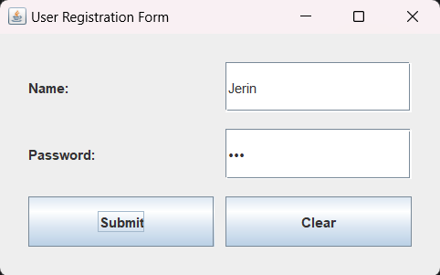

# Practical 7: User Form Using Java Swing

## Aim
To create a user form containing name and password fields using Java Swing.

## Theory
Java Swing is a GUI toolkit used to develop desktop applications in Java.

This program creates a user form using JFrame. It accepts a user's name and password and provides Submit and Clear buttons to perform basic form operations.

## Features
- Enter the user's name.
- Enter a password using a masked password field.
- Submit the form.
- Display a success message.
- Clear both input fields.

## Concepts Used
- Java Swing
- JFrame
- JPanel
- JLabel
- JTextField
- JPasswordField
- JButton
- GridLayout
- ActionListener
- ActionEvent
- JOptionPane
- Event Handling

## Source Code
`UserForm.java`

## Output

## Conclusion
Successfully developed a user form using Java Swing with name and password fields, Submit and Clear buttons, and event handling.