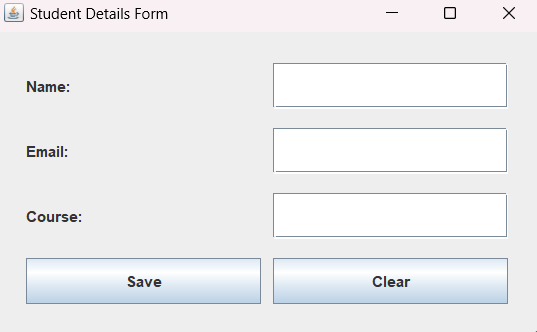

# Practical 8: Storing Form Data in a CSV File Using Java

## Aim
To develop a Java application that accepts user details through a graphical form and stores them in a CSV file using Java file handling.

## Theory
CSV (Comma-Separated Values) is a simple file format used to store tabular data in plain text.

This program uses Java Swing to create a form that accepts a user's name, email address, and course. When the Save button is clicked, the entered details are stored in a CSV file.

The program uses Java file handling classes to create and write to the CSV file. New records are appended without removing previously stored data.

## Features
- Accepts name, email, and course details.
- Stores entered details in a CSV file.
- Automatically creates the CSV file if it does not exist.
- Appends new records to existing data.
- Displays a success message after saving.
- Provides a Clear button to reset the fields.

## File Details
- File name: `user_details.csv`
- Location: `Practical 8/user_details.csv`
- Columns: Name, Email, Course

## Concepts Used
- Java Swing
- JFrame
- JPanel
- JLabel
- JTextField
- JButton
- ActionListener
- Java File Handling
- Path
- Files
- BufferedWriter
- IOException
- CSV File Format

## Source Code
`CSVForm.java`

## Output

## Conclusion
Successfully developed a Java application using Swing and file handling to store user-entered details in a CSV file.