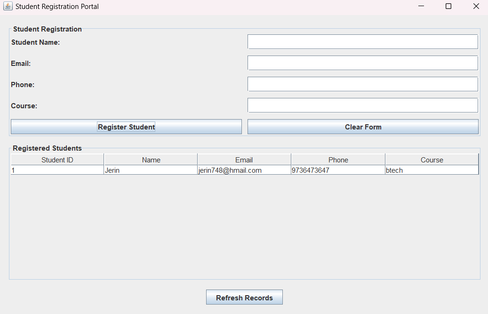

# Practical 9: Student Registration Portal Using Java and CSV

## Aim
To develop a Student Registration Portal using Java Swing that accepts student details, stores them in a CSV file, and displays registered student records.

## Theory
A Student Registration Portal is an application used to collect and manage student information.

Java Swing is used to create the graphical user interface, while CSV (Comma-Separated Values) is used to store student records in a file.

The application allows users to register students by entering their name, email, phone number, and course. Each student is assigned a unique sequential ID. The registered records are saved in a CSV file and displayed in a table.

## Features
- Register students using a graphical form.
- Accept student name, email, phone number, and course.
- Validate the entered information.
- Automatically generate a student ID.
- Store student records in a CSV file.
- Display all registered students in a table.
- Refresh the displayed records.
- Clear the registration form.

## File Details
- File name: `students.csv`
- Location: `Practical 9/students.csv`

### CSV Columns
- Student ID
- Name
- Email
- Phone
- Course

## Concepts Used
- Java Swing
- JFrame
- JPanel
- JLabel
- JTextField
- JButton
- JTable
- DefaultTableModel
- JScrollPane
- Event Handling
- Java File Handling
- BufferedReader
- BufferedWriter
- ArrayList
- CSV File Format

## Source Code
`StudentRegistrationPortal.java`

## Output

## Conclusion
Successfully developed a Student Registration Portal using Java Swing and CSV file handling. The application registers students, stores their details, and displays the saved records in a table.g